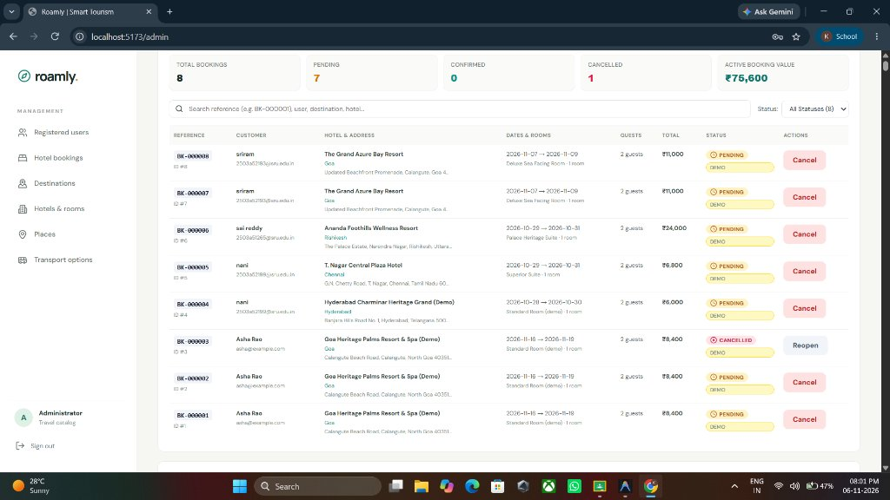

# Roamly – AI-Assisted Smart Tourism & Travel Management System

[](https://react.dev/)
[](https://flask.palletsprojects.com/)
[](https://www.postgresql.org/)
[](https://flask-jwt-extended.readthedocs.io/)
[]()

---

## 1. Project Title
**Roamly – AI-Assisted Smart Tourism & Travel Management System**

---

## 2. Project Overview
**Roamly** is a comprehensive, production-grade web application engineered to modernize destination exploration, personalized travel itinerary generation, verified lodging reservations, and intercity transit coordination. 

The platform bridges the gap between chaotic, multi-tab trip planning and an intuitive, all-in-one digital concierge. Built with a decoupled **React 18** client and a robust **Flask** REST backend, Roamly offers role-based access for both travelers (customers) and platform administrators, dynamic budget constraint solving, verified real-world Indian destination catalogs, interactive Google Maps geolocation, and realistic intercity transport schedules.

---

## 3. Problem Statement
Modern leisure travelers and tourists frequently encounter major friction points:
1. **Fragmented Planning**: Travelers juggle separate platforms for destination discovery, attraction timings, hotel bookings, and transit options.
2. **Budget Uncertainty**: Estimating realistic travel expenses across accommodations, ticket admissions, and transit is opaque and error-prone.
3. **Repeated & Misleading Imagery**: Many tourism portals use repeated stock photos or vehicle images for heritage monuments and hotels.
4. **Lack of Administrative Oversight**: Operators require centralized dashboards to track live room inventory, approve customer reservations, manage catalogs, and export auditing records.

---

## 4. Objectives
- Provide an intelligent, budget-aware **AI Trip Planner** that synthesizes multi-day schedules tailored to traveler preferences, group sizes, and spending thresholds.
- Enable end-to-end **Hotel Booking & Room Inventory Management** with date-specific occupancy tracking and verified check-in/check-out policies.
- Embed **Google Maps Geolocation & Turn-by-Turn Navigation** directly into destination cards and hotel vouchers, including taxi and auto rickshaw lookup.
- Offer **Bidirectional Intercity Transit Discovery** (Buses and Trains) covering major Indian corridors with 5 realistic time-slotted options per route.
- Implement an **Administrator Operations Portal** featuring revenue metrics, catalog editing (destinations, hotels, rooms, attractions), customer booking approval workflows, and protected Excel export.

---

## 5. Key Features
- **Role-Based Authentication**: Secure JWT-powered authentication separating customer accounts from administrative roles with password hashing via Werkzeug.
- **Three-Mode AI Travel Planner**:
  1. *Complete AI Itinerary & Budget*: Generates full multi-day daily schedules, entry costs, and matched transit.
  2. *Hotels Only Mode*: Budget-ranked accommodation search filtered by destination, travelers, and room capacity.
  3. *Transport Only Mode*: Direct intercity search returning 5 demo buses and 5 demo trains per city pair with departure filters.
- **Interactive Google Maps Integration**: Every hotel features direct Google Maps links, coordinates, directions, and nearby local transport (taxi/auto) discovery.
- **Live Inventory Engine**: Room inventory is checked against overlapping reservation dates (`check_in < req.check_out and check_out > req.check_in`).
- **Admin Approval & Booking Lifecycle**: Administrators review pending reservations, verify details, and approve them with instant status synchronization to the customer dashboard.
- **Audit-Ready Excel Export**: Administrators can download comprehensive `.xlsx` spreadsheets of all bookings, dates, and revenue metrics.
- **100% Unique Visual Assets**: Curated, verified high-resolution photographs for every destination, attraction, and hotel property with resilient `onError` frontend fallbacks.

---

## 6. Technology Stack

### Frontend
- **Framework**: React 18.3.1 (Single Page Application architecture)
- **Tooling & Bundler**: Vite 6.0.5 with Fast Refresh
- **Routing**: React Router DOM 6.28.0
- **Icons**: Lucide React
- **Analytics & Data Visualizations**: Recharts 2.15.0
- **Styling**: Modern responsive CSS3 with CSS Grid, Flexbox, custom design tokens, and CSS variables

### Backend
- **Framework**: Flask 3.0+ (Python 3.11 or newer)
- **ORM & Database Toolkit**: Flask-SQLAlchemy 3.1+ / SQLAlchemy 2.0+
- **Authentication**: Flask-JWT-Extended 4.6+ with role-based claims (`@customer_required`, `@admin_required`)
- **CORS Handling**: Flask-CORS 4.0+
- **Password Security**: Werkzeug Security (`generate_password_hash`, `check_password_hash`)
- **Reporting & Exports**: OpenPyXL 3.1+ (Excel workbook generation)
- **Environment Management**: Python-Dotenv 1.0+
- **Database Adapters**: SQLite 3 (local development) and Psycopg 3.2+ (PostgreSQL production)

---

## 7. System Architecture

```
┌─────────────────────────────────────────────────────────────┐
│                      Client Layer                           │
│     React 18 Single Page Application (Vite 6 / Port 5173)   │
│  ┌───────────────────────┐       ┌───────────────────────┐  │
│  │  Customer Dashboard   │       │  Admin Control Center │  │
│  │  - AI Trip Planner    │       │  - Catalog Manager    │  │
│  │  - Hotel Stays & Maps │       │  - Booking Approval   │  │
│  │  - Transport Search   │       │  - Analytics & Excel  │  │
│  │  - My Trips & History │       │  - Room Inventory     │  │
│  └───────────┬───────────┘       └───────────┬───────────┘  │
└──────────────┼───────────────────────────────┼──────────────┘
               │ JSON / HTTP REST APIs         │
               │ Bearer JWT Authentication     │
┌──────────────▼───────────────────────────────▼──────────────┐
│                      Backend Layer                          │
│               Flask 3 REST API (Port 5000)                  │
│  ┌───────────────────────────────────────────────────────┐  │
│  │ Security & Middlewares: CORS, JWT Verification, Roles │  │
│  ├───────────────────────────────────────────────────────┤  │
│  │ Core Services:                                        │  │
│  │ - Itinerary Constraint Solver (Budget & Interests)    │  │
│  │ - Dynamic Intercity Transport Engine (Buses & Trains) │  │
│  │ - Room Inventory & Date Availability Tracker          │  │
│  │ - OpenPyXL Excel Exporter                             │  │
│  └───────────────────────────┬───────────────────────────┘  │
└──────────────────────────────┼──────────────────────────────┘
                               │ SQLAlchemy 2 ORM
┌──────────────────────────────▼──────────────────────────────┐
│                     Persistence Layer                       │
│      SQLite (Default Development) / PostgreSQL (Production)  │
│  - Users & Roles                 - Transport Services       │
│  - Destinations & Regions        - Tourist Attractions      │
│  - Hotels & Room Inventories     - Bookings & Payments      │
└─────────────────────────────────────────────────────────────┘
```

---

## 8. Project Folder Structure

```
ai final/
├── backend/                           # Flask REST API Backend
│   ├── instance/                      # Local database instance folder
│   ├── .env.example                   # Backend configuration template
│   ├── app.py                         # Application factory, routes, and ORM models
│   ├── apply_image_fixes.py           # Catalog imagery synchronization script
│   ├── requirements.txt               # Python package dependencies
│   ├── seed_data.py                   # Master seed data for destinations and attractions
│   ├── seed_more_hotels.py            # Expanded 90-hotel property catalog
│   ├── test_app.py                    # 26 automated unit tests
│   ├── test_complete_transport_verification.py # Full transit verification suite
│   ├── test_transport_only_verification.py     # Transport-only mode verification
│   └── transport_generator.py         # Dynamic bus and train corridor engine
├── docs/                              # Project documentation & assets
│   └── screenshots/                   # Application screenshots
│       └── admin_hotel_bookings.jpg   # Admin booking approval view
├── frontend/                          # React + Vite Frontend SPA
│   ├── public/                        # Static assets
│   ├── src/
│   │   ├── components/                # Modular React UI components
│   │   │   ├── Admin.jsx              # Admin control panel and booking management
│   │   │   ├── DestinationStayList.jsx# Hotel catalog, filters, and stay booking modal
│   │   │   ├── HotelLocationModal.jsx # Interactive Google Maps dialog
│   │   │   ├── HotelRecommendations.jsx# Budget hotel recommendation cards
│   │   │   ├── ItineraryGenerator.jsx # 3-in-1 AI Trip Planner & Itinerary Viewer
│   │   │   └── TransportSearch.jsx    # Standalone transport search component
│   │   ├── App.jsx                    # Root application component & customer trips
│   │   ├── main.jsx                   # React DOM entry point
│   │   └── styles.css                 # Master application stylesheet
│   ├── index.html                     # Frontend HTML entry point
│   ├── package.json                   # Node.js dependencies and scripts
│   └── vite.config.js                 # Vite build & proxy configuration
├── .env.example                       # Root environment configuration template
├── .gitignore                         # Comprehensive version control ignore rules
└── README.md                          # Project documentation
```

---

## 9. Prerequisites
Ensure you have the following installed on your operating system:
- **Python**: Version 3.11, 3.12, 3.13, or 3.14
- **Node.js**: Version 18.0 or newer (Node.js 20+ recommended)
- **npm**: Version 9.0 or newer
- **Git**: Installed and configured in your path

---

## 10. Installation Instructions

Clone the repository to your local machine:
```bash
git clone https://github.com/2503a52193-lab/smart-tourism.git
cd smart-tourism
```

---

## 11. Frontend Setup

1. Navigate to the frontend directory:
   ```powershell
   cd frontend
   ```
2. Install the required Node packages:
   ```powershell
   npm install
   ```
3. Verify that the build completes without errors:
   ```powershell
   npm run build
   ```

---

## 12. Backend Setup

1. Navigate to the backend directory:
   ```powershell
   cd ../backend
   ```
2. Create and activate a Python virtual environment:
   ```powershell
   # Windows PowerShell
   python -m venv .venv
   .\.venv\Scripts\Activate.ps1
   ```
3. Install the Python dependencies:
   ```powershell
   pip install -r requirements.txt
   ```

---

## 13. Database Setup

Roamly uses an automated SQLite database configuration out of the box for quick setup.

1. Ensure your virtual environment is active in the `backend/` folder.
2. Initialize and seed the catalog data (15 verified destinations, 60 attractions, and 90 hotels):
   ```powershell
   python -m flask --app app init-db
   python -m flask --app app seed-data
   ```
3. Create the default administrator account:
   ```powershell
   python -m flask --app app create-admin
   ```
   *(Enter your desired administrator username, email, and password when prompted)*

---

## 14. Environment Configuration

Create a `.env` file inside the `backend/` directory by copying `backend/.env.example`:

```powershell
cd backend
Copy-Item .env.example .env
```

Configure the variables inside `backend/.env`:
```ini
# Database Connection (SQLite by default; or use PostgreSQL)
DATABASE_URL=sqlite:///tourism_local.db

# JWT Security Key (Replace with a strong random 32+ character key)
JWT_SECRET_KEY=your-secure-random-jwt-secret-key-here

# Token Expiry (minutes)
JWT_ACCESS_TOKEN_MINUTES=60

# Frontend URL for CORS
FRONTEND_ORIGIN=http://localhost:5173
```

---

## 15. How to Run the Project Locally

Run the backend and frontend in two separate terminal windows.

### Terminal 1: Backend Server (Flask)
```powershell
cd "backend"
.\.venv\Scripts\Activate.ps1
python -m flask --app app run --host 127.0.0.1 --port 5000
```
> Backend runs at **http://127.0.0.1:5000**

### Terminal 2: Frontend Server (Vite / React)
```powershell
cd "frontend"
npm run dev
```
> Frontend runs at **http://localhost:5173**

Open your browser and navigate to **http://localhost:5173/**.

---

## 16. User (Customer) Features
- **Account Registration & Login**: Instant self-service customer registration with automatic JWT session management.
- **AI Trip Planner**: Interactive planning with customizable budgets, traveler counts, day durations, and interest tags (Heritage, Nature, Food, Adventure, Culture).
- **Interactive Hotel Explorer**: View verified hotel rates, policies, star ratings, and photo galleries across 15 popular Indian destinations.
- **Stay Reservation Modal**: Select check-in and check-out dates, calculate room totals, verify capacity, and submit booking requests.
- **My Trips Dashboard**:
  - Track active hotel reservations with real-time status updates (*Pending*, *Confirmed*, *Cancelled*).
  - Prominent confirmation alerts once an administrator approves a booking.
  - Access Google Maps turn-by-turn navigation and local taxi/auto lookup for every booked stay.
  - Cancel pending bookings with instantaneous room inventory release.

---

## 17. Administrator Features
- **Secure Admin Sign-In**: Dedicated role-verified login route (`/admin/login`).
- **Live Performance Metrics**: Real-time counter cards for Total Bookings, Pending Requests, Confirmed Bookings, Cancelled Stays, and Active Revenue Value.
- **Booking Status Management**:
  - Review all customer reservations.
  - Confirm pending bookings with a single click.
  - Cancel or reopen reservations with automatic inventory re-calculation.
- **Catalog Management**:
  - Add, edit, archive, and restore destinations.
  - Add and edit hotels, policies, room types, nightly rates, and capacity limits.
  - Manage tourist attractions, operating hours, and verified admission fees.
- **Excel Audit Export**: One-click download of all bookings in `.xlsx` format powered by `openpyxl`.

---

## 18. AI Itinerary and Budget Planning
Roamly features an intelligent multi-tiered itinerary generator:
1. **Mathematical Constraint Solver**: Compares total trip budget against accommodation rates, attraction entry fees, transit expenses, and daily per-diem allowances.
2. **Interest Alignment**: Attracts and ranks destinations and monuments based on selected interest tags.
3. **Daily Schedule Synthesizer**: Formulates morning, afternoon, and evening activity blocks with timing guidance and suggested experiences.
4. **Thematic Activity Fillers**: Long multi-day itineraries dynamically incorporate verified local experiences (Cultural Bazaars, Sunset Shoreline Promenades, Heritage Dining, and Nature Trails) with tailored imagery.

---

## 19. Hotel Booking and Google Maps Integration
Every accommodation listed in Roamly contains verified geographic coordinates:
- **Direct Google Maps Launch**: Click *"View on Google Maps"* on any property card or booking voucher to explore nearby roads and landmarks.
- **Turn-by-Turn Directions**: The *"Get Directions"* action computes driving and transit routes from the traveler's origin directly to the hotel entrance.
- **Local Transit Discovery**: Dedicated links search nearby registered taxi stands and auto rickshaw points on Google Maps around the hotel.

---

## 20. Demo Bus and Train Transport Module
Roamly incorporates a realistic, simulated intercity transport engine:
- **Coverage**: Covers all 15 supported destinations across India in bidirectional pairs (e.g., Hyderabad ↔ Chennai, Bengaluru ↔ Goa, Delhi ↔ Agra, Mumbai ↔ Manali).
- **5 Realistic Buses Per Route**: Spread across Early Morning, Late Morning, Afternoon, Evening, and Night departure windows.
- **5 Realistic Trains Per Route**: Modeled on Indian Railways corridors with realistic train numbers, journey durations, class options (SL, 3A, 2A, 1A, CC), and fares.
- **Demo Clarification**: All transport schedules and fare estimates are realistic demonstration records for educational travel planning and do not represent live reservation bookings.

---

## 21. Screenshots

### Administrator Hotel Bookings & Approval Dashboard

*Real-time booking management interface allowing administrators to review customer details, inspect dates and room types, confirm reservations, and export Excel reports.*

---

## 22. Testing Instructions

Roamly includes comprehensive automated test suites covering backend API endpoints, inventory logic, transit corridors, and role-based access.

### Run Backend Unit Tests
From the `backend/` directory with the virtual environment activated:
```powershell
python -m unittest test_app.py
```
> Expected Output: **26 tests passed (OK)**

### Run Transport & Corridor Verification Tests
```powershell
python test_transport_only_verification.py
```
> Expected Output: **100% SUCCESS across all bidirectional routes and daily availability checks**

### Run Frontend Production Build Check
```powershell
cd ../frontend
npm run build
```
> Expected Output: **Vite build complete with 0 errors**

---

## 23. Known Limitations
- Transport schedules and train/bus booking buttons connect to external official portals or demo dialogs rather than live ticketing GDS APIs.
- Payment gateway integration operates in simulation mode; demonstration reservations do not charge real credit cards.
- Multi-city complex flight routing is outside the scope of the current intercity rail and bus model.

---

## 24. Future Improvements
- Direct integration with IRCTC and RedBus live inventory APIs.
- Payment gateway integration (Razorpay / Stripe) for live booking settlement.
- PWA (Progressive Web App) offline support for downloaded travel vouchers and itineraries.
- Multi-language localization supporting Hindi, Telugu, Tamil, and other regional Indian languages.

---

## 25. Team Members
- **Project Lead & Full-Stack Developer**: Sriram Koduri (`2503a52193-lab`)

---

## 26. Academic Project Acknowledgement
This project was developed as a comprehensive Capstone / Final Project for the **AI-Assisted Smart Tourism & Travel Management System**. Special thanks to faculty mentors, academic advisors, and open-source contributors for guidance and technical support throughout system design, security hardening, and implementation.

---
*Developed with dedication for seamless Indian tourism and intelligent travel planning.*
